### Greg Uezono | 🏄 🤿 💻 

<a href="https://greguezono.github.io/digital-home/">
  <picture>
    <source media="(max-width: 600px) and (prefers-color-scheme: dark)" srcset="assets/digital-home-compact-dark.svg">
    <source media="(max-width: 600px) and (prefers-color-scheme: light)" srcset="assets/digital-home-compact-light.svg">
    <source media="(prefers-color-scheme: dark)" srcset="assets/digital-home-wide-dark.svg">
    <source media="(prefers-color-scheme: light)" srcset="assets/digital-home-wide-light.svg">
    
  </picture>
</a>

Built from my GitHub PR history. <a href="https://greguezono.github.io/digital-home/">Interactive report →</a> · <a href="https://greguezono.github.io/digital-home/#personal">Travel atlas →</a>
